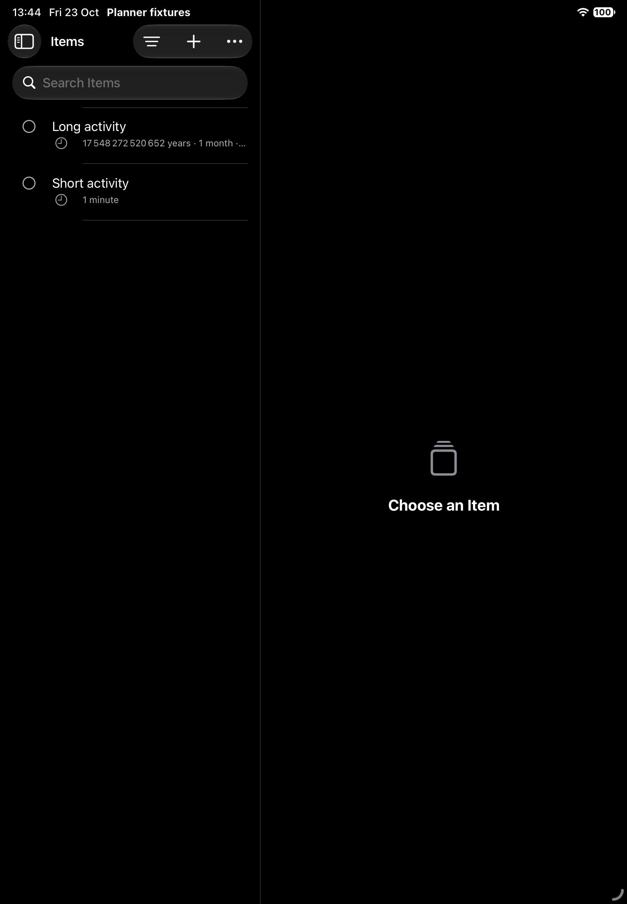

# Native catalog toolbar compatibility

Status: the narrow iPad correction and affected phone/tablet journeys pass, with matching Mac compilation. This is a targeted compatibility correction; final whole-app polish, Mac interaction and physical acceptance remain open.

## Reproduction and correction

The existing `CatalogTitleLayoutJourneyTests.testItemCatalogTitlesRemainReadableBesideNativeToolbarActions` fails on the actual dark iPad fixture. Its 340-point Items pane gives the title 32.5 points when its native headline needs about 44.4. The retained capture shows `It…` beside four direct controls. [Original failed execution and frames](evidence/native-catalog-toolbar-compatibility/catalog-title-dark-tablet-existing-red/boundary-validation.json).

Lowering the native visibility priority for View and Sort makes no difference. That two-line probe is reverted. [Failed priority probe](evidence/native-catalog-toolbar-compatibility/catalog-title-dark-tablet-priority-probe/boundary-validation.json). An earlier attempt selected the wrong test scheme and starts no test; it supplies no reproduction credit.

Items and Inbox now measure their actual content pane. In narrow mobile panes, Filters and Add remain direct and View/Sort occupy Apple's native More menu. Wider panes retain direct controls. Mac keeps its direct controls. This reuses the existing compact List overflow pattern without changing query, selection, sorting, creation or Map identities. [Apple's ToolbarOverflowMenu](https://developer.apple.com/documentation/swiftui/toolbaroverflowmenu) always places its contents in the native overflow menu; visibility priority alone does not establish title readability on this runtime.

The unchanged title test then passes for Items and Inbox. Their native title frames are 44.5 and 44 points respectively, at the same 340-point pane width. Both original captures are inspected. [Passing execution](evidence/native-catalog-toolbar-compatibility/catalog-title-dark-tablet-native-overflow/boundary-validation.json).

## Interaction qualification

A second journey at the existing production-view fixture boundary switches both catalogs to Map and back, selects descending sort, opens/closes Filters and cancels New Item. It passes in 167.008 seconds. Both original final captures are inspected. Native journey helpers now resolve menus through the existing overflow control rather than assuming every action has a direct toolbar button. [Executed result](evidence/native-catalog-toolbar-compatibility/catalog-toolbar-dark-tablet-controls/boundary-validation.json).

The selected Core import test added afterward is unrelated to this view correction. Source manifests distinguish each execution's exact inputs. No physical performance, whole-app visual acceptance or signed-storage qualification is inferred from these narrow journeys.

## Affected native regressions and final compilation

The [corrected dark iPad cohort](evidence/native-catalog-toolbar-compatibility/catalog-toolbar-dark-tablet-corrected/boundary-validation.json) passes four functions: title readability, both catalogs' View/Sort/Filters/Add controls, temporary native Map address choices and independent-writer Map refresh. The functions pass in 19.611, 166.027, 108.613 and 51.549 seconds respectively. An earlier regression still looked up a direct Map action after its move into native overflow; it fails and is retained without aggregate pass credit. The corrected driver uses the native menu choice.

The [light-phone regression](evidence/native-catalog-toolbar-compatibility/catalog-toolbar-light-phone-regression/boundary-validation.json) passes title readability, temporary Map choices, independent-writer refresh and the existing 5,000-Item search/sort journey. Its fifth function fails after New Item opens because the test incorrectly requires Cancel; the actual compact editor provides its accepted Back control. The retained native hierarchy establishes that cause. Accepting either published Cancel/Back control changes only the test. The [corrected complete controls function](evidence/native-catalog-toolbar-compatibility/catalog-toolbar-light-phone-controls-corrected/boundary-validation.json) then passes in 135.610 seconds for Items and Inbox. Both final original captures are inspected. This is five distinct passing phone functions across two epochs, not a single all-green five-function invocation.

The [epoch reconciliation](evidence/native-catalog-toolbar-compatibility/mobile-epoch-reconciliation.json) verifies identical production inputs across the final mobile executions and records the explicit test/fixture differences. Every retained product is verified before reuse. The final [Mac build-for-testing](evidence/native-catalog-toolbar-compatibility/catalog-toolbar-final-mac-compiler/boundary-validation.json) passes in 5.949 seconds at the same 1,094 inputs as the corrected phone function. All nine retained product hashes match. Strict lint covers the affected production and native journey files, and Markdown/whitespace checks pass.

This closes the represented Items/Inbox toolbar correction. Actual Mac interaction, narrower selected-List toolbar behavior, actual Map-column widening, broader text sizes/contrast and final whole-app polish remain open. No account/team setup or protected signed-storage qualification is claimed.
